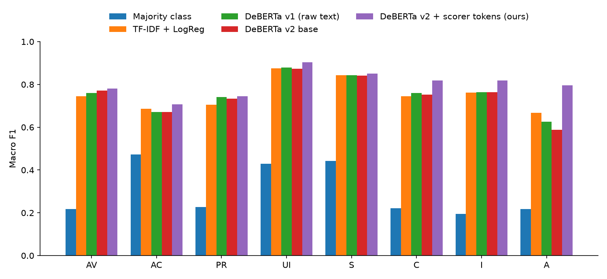
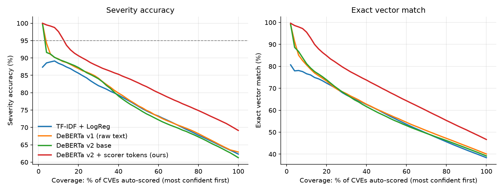

# CVEscore

Predict the full **CVSS v3.1 base vector** (AV, AC, PR, UI, S, C, I, A) of a vulnerability from its raw CVE description, then compute its base score and severity with the official formula.

**Model:** [huggingface.co/angronain/cvescore-deberta](https://huggingface.co/angronain/cvescore-deberta) (v2 scorer-token model; v1 is in the repo history)

## Results

Trained on 143,380 CVEs published before 2025, tested on **123,459 CVEs published from 2025-01-01 to 2026-10-30**: data the model has never seen, from the future relative to training. CVSS vectors and scores quoted in descriptions are removed before training and prediction.

The published model reads who scores the CVE before its description: `[NVD] ...` or `[CNA: wordfence] ...`. The scoring organisation is known when a CVE is published. Below, each test CVE is tagged with its real scorer.

| System | Exact vector | Severity acc. | Score MAE | Mean macro F1 (8 metrics) | ms/CVE |
|---|---|---|---|---|---|
| Majority class | 0.083 | 0.128 | 2.84 | 0.303 | <0.01 |
| TF-IDF + LogReg | 0.384 | 0.623 | 1.09 | 0.754 | 0.05 (CPU) |
| DeBERTa v1 (raw text, no scorer) | 0.401 | 0.629 | 1.04 | 0.756 | 0.99 (RTX 5080) |
| **DeBERTa v2 + scorer tokens (ours)** | **0.467** | **0.691** | **0.86** | **0.803** | 1.01 (RTX 5080) |

| | Exact vector | Severity acc. |
|---|---|---|
| CVEs scored by NVD (31,575) | 0.552 | 0.714 |
| CVEs scored by the CNA/vendor (91,884) | 0.438 | 0.684 |

Per-metric macro F1, v2: AV 0.782 · AC 0.707 · PR 0.746 · UI 0.903 · S 0.851 · C 0.819 · I 0.819 · A 0.796.



### Key findings

1. **Knowing the scorer is worth more than the encoder.** v1 beat TF-IDF by only +1.5 pts exact. v2 beats it by **+8.3 pts exact (95% CI +8.0 to +8.5)** and +6.8 pts severity accuracy (+6.5 to +7.1), in a paired bootstrap on the same CVEs. Almost all of the gain comes from CNA-scored CVEs. Each CNA scores in a consistent style that the model learns once it is told who is scoring (see [v2](#v2-who-scored-the-cve-matters-more-than-cleaner-labels)).
2. **The lead holds every quarter.** v2 is 7–9 pts ahead of TF-IDF on exact vectors in every quarter: 0.559 vs 0.468 in 2025 Q1, 0.425 vs 0.338 in 2026 Q3.
3. **Accuracy drops mostly because NVD stopped scoring, not because the model decays.** NVD's own scores were 38% of test labels in early 2025 and are 8% by late 2026. Agreement with CNAs varies widely: 97% exact for Oracle, 82% for Adobe, 69% for Wordfence and 56% for Microsoft, versus 25% for GitHub and Red Hat and 12% for MITRE.
4. **Score is close even when the vector is wrong.** 69% of predictions are within ±1.0 of the true base score and 83% within ±2.0. Only 4.2% are off by two or more severity levels. The main error is High ↔ Medium/Critical confusion.
5. **Confidence is informative, so triage works.** The 10% most confident predictions are 98% severity-accurate (96% exact vector); the 10% least confident are 41%. At a severity-accuracy target of 85%, **41% of new CVEs can be auto-scored**. At 80% the share is 60%, and at 95% it is 13% (v1: 28%, 40% and 4%). When v2 and TF-IDF predict the same vector (51% of CVEs), severity accuracy is 78% versus 60% when they disagree, so agreement between the two is a cheap second check.
6. **Quoted answers are removed, and the model doesn't need them.** 3.6% of test descriptions, mostly Oracle's, quote a CVSS vector or score. v2 never sees those quotes. Excluding these CVEs anyway, it scores 0.448 exact and 0.680 severity accuracy. Oracle stays at 97% exact because its fixed description template ("Easily exploitable vulnerability allows unauthenticated attacker with network access via HTTP...") spells out the vector in words.

Full tables: [`results/results.md`](results/results.md) (from `src/evaluate.py`) and [`results/analysis.md`](results/analysis.md) (from `scripts/analyze_results.py`: significance, confusion matrix, drift, per-CNA, calibration). v1 numbers are in the git history.



## v2: who scored the CVE matters more than cleaner labels

Most of the remaining error comes from the labels themselves, not the model. On the 2025+ CVEs that both NVD and the CNA scored, the two give the same vector only 18% of the time, and the same severity only 44% of the time. v2 tests three ways to deal with that. Every v2 model reads descriptions with quoted CVSS vectors and scores removed (`src/cvss_text.py`), so it can no longer copy the answer.

| System | NVD-scored exact | CNA-scored exact | All exact | All severity | All MAE |
|---|---|---|---|---|---|
| TF-IDF + LogReg (clean text) | 0.485 | 0.349 | 0.384 | 0.623 | 1.09 |
| v1 (raw text) | 0.546 | 0.351 | 0.401 | 0.629 | 1.04 |
| v2 base (clean text) | **0.558** | 0.335 | 0.392 | 0.613 | 1.06 |
| + label correction | 0.555 | 0.338 | 0.394 | 0.617 | 1.06 |
| + scorer tokens | 0.552 | **0.438** | **0.467** | 0.691 | 0.86 |
| + scorer tokens + label correction | 0.552 | 0.432 | 0.463 | **0.693** | **0.85** |

- **Scorer tokens** prefix each training row with whoever gave its label, for example `[NVD] ...` or `[CNA: wordfence] ...`. A CVE scored by both NVD and its CNA becomes two rows. At test time each CVE gets the tag of its scorer, which is known when the CVE is published. This raises exact match on CNA-scored CVEs by **+10.3 pts (95% CI +10.0 to +10.6)**, and overall exact match goes from 0.392 to 0.467. CNA labels are not random noise: each scorer has a consistent style, and the model learns it once it knows who is scoring.
- **Label correction** uses a second model, the corrector. It reads the CNA's vector, the CNA's identity and the description, and predicts NVD's vector. On test CVEs scored by both, it gets **0.597 exact**, against 0.431 for a per-CNA lookup table and 0.181 for copying the CNA's vector. It rewrote 22% of the CNA-only training vectors, but that changed nothing measurable on the main task (−0.3 pts on NVD-scored CVEs, CI includes 0). With 120k NVD labels already in training, 17k relabelled rows add little.
- **Removing quoted vectors costs almost nothing.** v2 base beats v1 on NVD-scored CVEs (+1.2 pts) and loses 1.6 pts on CNA-scored ones, where some vendors quoted the answer.

Full tables, per-metric corrector accuracy and bootstrap intervals: [`results/ablation.md`](results/ablation.md) (from `scripts/ablation_report.py`). The Hugging Face model is the scorer-token model; its card explains the `[NVD]` / `[CNA: org]` prefix.

## Why this project

New CVEs often wait days or weeks before NVD scores them, and since 2025 most never get an NVD score at all. A fast local model that pre-scores them, and flags the ones it is unsure about, helps security teams triage.

- **Time-based split.** Train on CVEs published before 2025, test on 2025+ CVEs. Most published work uses random splits, which leak near-duplicate descriptions between train and test and overstate accuracy.
- **Full vector, not just a severity label.** 8 classification heads on one shared encoder.
- **Human in the loop.** Each prediction has a confidence score; low-confidence CVEs are routed to an analyst. The report shows how many CVEs can be auto-scored at a given accuracy target.
- **Optional zero-shot LLM baseline** (`make pipeline-llm`, LM Studio on the host). It was not included in this run.

## Quickstart (Docker, NVIDIA GPU)

Requirements: Docker with Compose v2.26+, NVIDIA driver, and the NVIDIA Container Toolkit
(Arch: `pacman -S nvidia-container-toolkit && sudo nvidia-ctk runtime configure --runtime=docker && sudo systemctl restart docker`;
Windows: Docker Desktop with the WSL 2 backend).

```bash
cp .env.example .env          # optional: edit settings
make data                     # download NVD feeds + build train/test (~10 min)
make smoke                    # 1-minute GPU check
make pipeline                 # baselines + training + evaluation
make pipeline-llm             # same, plus the LM Studio zero-shot baseline
make demo                     # Gradio demo on http://localhost:7860 (RUN_NAME=v2_tokens in .env for v2)
make push                     # upload model + model card to Hugging Face
```

Without Docker: `make local-install` then `make local-pipeline` (in a Python 3.12 venv).

The defaults are tuned for an RTX 5080 (16 GB): bf16 autocast, batch size 32, max 256 tokens, 3 epochs.
PyTorch comes from the CUDA 12.8 wheels, which are required for RTX 50-series GPUs.

## Pipeline

| Step | Script | Output |
|---|---|---|
| Download NVD JSON 2.0 feeds (skips unchanged ones, checks SHA-256) | `src/fetch_nvd.py` | `data/raw/` |
| Parse, keep CVSS v3.1 CVEs, split by publication date | `src/prepare_data.py` | `data/processed/{train,test}.parquet` |
| Majority + TF-IDF/LogReg baselines | `src/baselines.py` | `results/preds_{majority,tfidf}.parquet` |
| Zero-shot LLM baseline via LM Studio | `src/llm_baseline.py` | `results/preds_llm.parquet` |
| Fine-tune encoder with 8 heads | `src/train.py` | `checkpoints/deberta/`, `results/preds_deberta.parquet` |
| Tables, coverage plot, per-metric F1 | `src/evaluate.py` | `results/results.md`, `*.png` |
| Significance, drift, per-CNA, calibration | `scripts/analyze_results.py` | `results/analysis.{md,json}` |
| v2 training sets: corrector, scorer tokens, corrected labels | `src/make_variants.py` | `data/variants/<name>/` |
| v2 ablation tables | `scripts/ablation_report.py` | `results/ablation.{md,json}` |
| Demo | `app.py` | Gradio UI |
| Publish | `scripts/push_to_hub.py` | Hugging Face model + card |

**Splits:** train = published before 2024-10-01, validation (checkpoint selection) = Oct to Dec 2024, test = 2025-01-01 onwards. Test CVEs whose description exactly matches a training description are removed.

**Labels:** NVD's own score (`Primary`) when available, otherwise the CNA/vendor score (`Secondary`). Results are reported separately for both.

**Confidence:** product of the 8 heads' top softmax probabilities.

## Keeping the data fresh

`fetch_nvd.py` only downloads feeds whose checksum changed, so it can run daily (cron, systemd timer or CI) to grow the test set with new CVEs.

## Limitations

- English descriptions only. Vague descriptions ("unspecified vulnerability") are hard for any model.
- NVD and CNA scores disagree on most CVEs scored by both (18% exact agreement in 2025+), which caps achievable accuracy.
- The zero-shot LLM may have seen 2025 CVEs during pretraining if it was released after them.
- CVSS v3.1 only; CVSS v4.0 is not covered yet.
