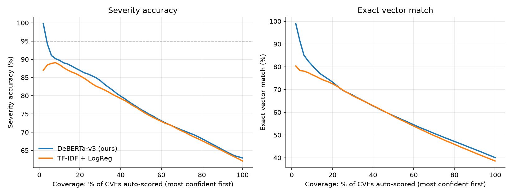
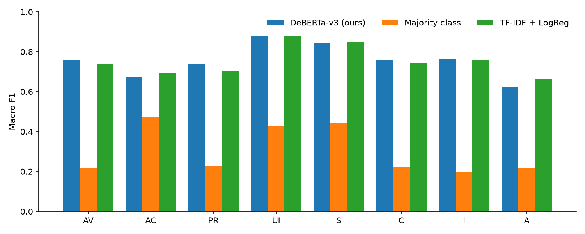

# CVEscore results

Test set: 123,460 CVEs published from 2025-01-01 to 2026-10-30. Per-metric columns are macro F1.

## Full test set

| System | N | AV | AC | PR | UI | S | C | I | A | Exact | Sev. acc | Sev. F1 | Score MAE | ms/CVE |
|---|---|---|---|---|---|---|---|---|---|---|---|---|---|---|
| DeBERTa-v3 (ours) | 123460 | 0.761 | 0.672 | 0.741 | 0.880 | 0.843 | 0.760 | 0.764 | 0.625 | 0.401 | 0.629 | 0.403 | 1.036 | 0.985 |
| Majority class | 123460 | 0.217 | 0.472 | 0.227 | 0.428 | 0.442 | 0.221 | 0.196 | 0.217 | 0.083 | 0.128 | 0.045 | 2.840 | 0.001 |
| TF-IDF + LogReg | 123460 | 0.740 | 0.694 | 0.702 | 0.877 | 0.849 | 0.745 | 0.760 | 0.665 | 0.386 | 0.621 | 0.397 | 1.094 | 0.051 |

## By scoring source (exact vector match / severity accuracy)

Primary = scored by NVD (31,575), Secondary = scored by the CNA/vendor (91,885).

| System | Primary exact | Primary sev | Secondary exact | Secondary sev |
|---|---|---|---|---|
| DeBERTa-v3 (ours) | 0.546 | 0.710 | 0.351 | 0.602 |
| Majority class | 0.144 | 0.176 | 0.061 | 0.112 |
| TF-IDF + LogReg | 0.485 | 0.677 | 0.352 | 0.602 |

## Human-in-the-loop triage

Predictions are sorted by confidence (product of the 8 heads' top probabilities). The rest go to an analyst.

| System | Auto-scored at 95% severity acc. |
|---|---|
| DeBERTa-v3 (ours) | 3.8% |
| TF-IDF + LogReg | 0.0% |

## Per-metric macro F1

